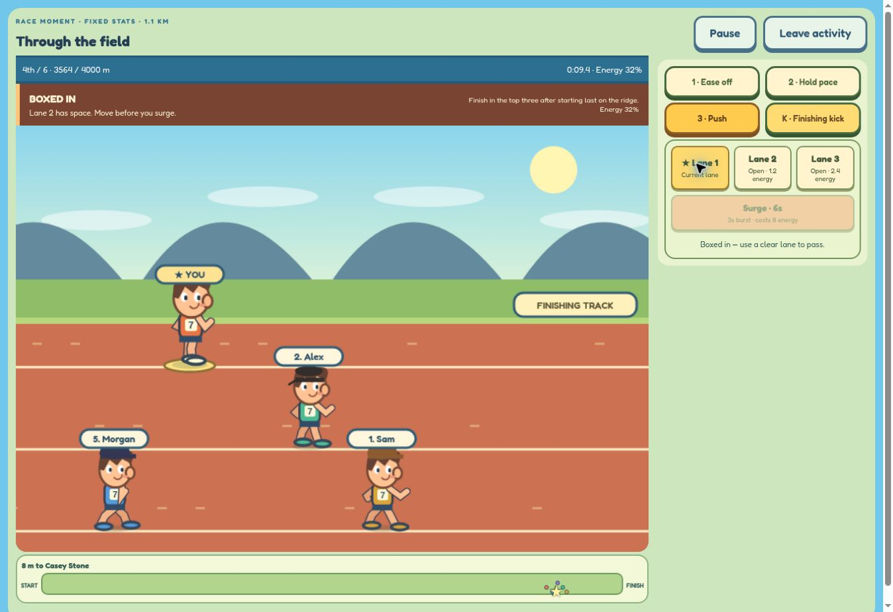

# Chasing Varsity

## [▶ Play Chasing Varsity in your browser](https://chasing-varsity.nativebolt2.chatgpt.site/)

**Click to play — no download or installation.** Created by **Daniel O’Keefe**. Train your rookie, build a cross-country team, and race from Pine Hollow to Varsity Nationals. Original cartoon artwork, keyboard and touch controls, and automatic browser saves.

## Freshman year update — new in 1.0.0

- **A six-chapter first season:** Coach and teammates guide your first workout, first race, varsity spot, qualification and national title. Post-race conversations respond to milestones and rival results.
- **A real bench and lineup:** keep four original teammates and six recruits. Choose four to six teammates alongside your captain. Scout course fit and get lineup recommendations. Training develops the whole squad; only selected partners help during races.
- **Three new training games:** an accelerating 18-beat interval ladder; six endurance checkpoints; and a 1,000 m obstacle time trial where missed jumps slow you. Each has a success goal, saved best score and retry.
- **Finish celebrations:** illustrated finish scenes, crowd reactions, personal-best improvements, team victories and underdog wins, plus the existing finish replay.
- **Gradual onboarding:** advanced team/race options appear after a first finish; alternate drills appear after one workout. “Explore all activities” skips introductions. Existing saves retain progress.
- **Verification:** fresh-save full-season controller test, skill-versus-idle drill tests, save validation and lineup/partner checks. See [v1.0 checks and limits](docs/V10-PLAYTEST.md).

## Adventure update — new in 0.9.0

- **A larger race view:** bigger runners, a closer camera, and controls beside the action on desktop and landscape phones. Portrait phones keep controls below the course. A nearby blocker stays visible, while other crowded runners remain represented in the field map and scores.
- **Six distinct scenes:** meadow groves, lakeside water and docks, pine forest, mountain ridges, autumn farmland, and a championship grandstand. Sloped trails, mud, rain, wind, and the finishing track reflect the simulation's current terrain and conditions.
- **Deeper training:** variable beat timing, moving effort targets, and changing obstacle spacing. Every three combo hits/seconds adds two bonus coins, up to ten. Reach 70% quality in any discipline to unlock optional Challenge training. Challenge uses faster patterns and tighter targets; 65% quality earns eight additional coins. Existing personal bests count toward the unlock. Standard training stays available.
- **Three race moments:** catch a breakaway over the last 800 m, move from last into the top three on a 1.1 km ridge finish, or defend a narrow team lead in a ten-runner showdown. Each uses a fixed temporary squad, so training and recruitment do not buy the solution. First wins pay 50 coins once; retries are free.
- **Accomplishment unlocks:** the breakaway unlocks County Park's creek variation; the ridge challenge unlocks its sunset variation; the team challenge unlocks a teal captain's singlet. Select them in Goals. Normal course qualification still applies. Calendar routes remain fixed, and variation ghosts are stored separately.
- **Verification:** all three scenarios lose under a no-action, hold-pace strategy and can be won by a tested tactical strategy. Both training difficulties are solvable with normal controls. See [v0.9 checks and limits](docs/V09-PLAYTEST.md).



## Balance and race clarity — new in 0.8.0

- **Training variety:** switching disciplines after a completed session adds +2 stat points and +5 coins at 55% quality or better, while that stat is below 100. A coach card recommends your weakest stat and shows the next field's rating.
- **Fairer passing:** runners cannot slip through a leader less than eight metres ahead. Changing lanes checks every crossed lane, requires four metres of clearance, and costs 1.2 energy per lane crossed. Opponents avoid unnecessary weaving; lane buttons explain blocked gaps, energy costs, and cooldowns.
- **One clear race cue:** the banner prioritizes recovery, passing opportunities, approaching forks, and the final kick. Relevant rival attacks and drafting feedback appear when no more urgent action is needed. Optional sound cues accompany recovery, route, and kick prompts.
- **Phone controls:** larger lane targets and a scrollable control panel keep tactical actions reachable at narrow widths. The race view was checked in a 390 × 844 browser frame, including pause/resume and completed team results.
- **Harder later circuits:** Elite fields now range from 82–93 and Legends from 92–98. Deterministic campaign checks cover all 18 meets at two training-quality levels. See [balance methodology and results](docs/BALANCE.md).

Existing saves, medals, and records remain available.

## Race day — new in 0.7.0

- **Forecasts that affect racing:** quick races offer Sunlit trail, Rain/creek loop, and Wind/ridge loop. Rain adds muddy sections, a strength-dependent speed penalty, and a small energy cost. Wind adds a climb and descent, with headwind from 35–75%; drafting provides shelter. The season calendar fixes each meet’s forecast so replays stay fair. The course strip reflects the selected layout.
- **Rivals with readable attacks:** each rival has an energy budget and distinct timing. Reed attacks early, Casey hunts hills, Alex builds late, Morgan saves a late surge, and Sam can launch one finishing burst. A 1.5-second warning precedes these attacks; cooldowns and energy costs prevent endless surges. Rivals can recover ahead of climbs.
- **Running partnerships and specialties:** choose a captain’s partner in Team. Within 45 metres, both runners save 4–10% energy. Finish a team race with at least three seconds together to earn one bond level, capped at ten. Teammates’ strongest stats define specialties: 2% uphill speed for climbers, 2% final-fifth speed for finishers, or 5% energy savings for pacers. Training can change a specialty.
- **Expressive runners and podiums:** tired runners show fatigue, bursts use a forward lean, and finishers raise their arms. Podiums use the actual cartoon runner artwork and show individual winners or team scores. Reduced-motion preferences suppress running motion and automatic replay playback.
- **Recorded finish highlights:** watch roughly the last 11–16 seconds around your finish at half speed, pause, or scrub the recorded positions. The camera follows your runner. Quarter-split highlights identify where you gained or lost places. Replays stay in memory for the current race and never grant rewards.
- **Phone and balance polish:** compact controls retain 48-pixel touch targets, hide redundant instructions during racing, and avoid the sound toggle covering controls. Frame catch-up is bounded and uses a single simulation clock. All six courses and three forecasts were simulated for completion and trained qualification; a fully trained team can win Legends nationals under each forecast.

Ghosts and previous split comparisons are separated by weather, course, mode, and (for ghosts) career circuit. Existing clear-weather records remain available. Exported saves include partnerships and weather ghosts; imports accept up to 8 MB. Older saves retain their progress.

## Career and replayability — new in 0.6.0

- **A six-meet team season:** race the first five meets in order, earn 10/7/4/2 league points, and finish in the top two to qualify for nationals. Replays keep your best result instead of farming points. See league standings and named rivals’ results after each meet.
- **Elite and Legends circuits:** winning nationals unlocks a harder season with stronger opponents. Earn and equip championship ribbons while keeping your runner, team, trophies, and earlier results.
- **Guided tactical practice:** learn drafting, passing, surging, route choice, and a finishing kick alongside Coach. Retry each lesson without spending coins or changing race records and stats.
- **Your personal-best ghost:** completed races record a translucent replay runner. Ghosts are separate for each course, mode, and career circuit; toggle them in Runner. Recording starts with this update and ghosts never block or draft.
- **Clearer racing:** smooth lane changes, a branching route preview, visible drafting wakes, and surge/kick effects that follow your runner. Reduced-motion settings are respected.
- **Portable saves:** Runner → Export save downloads a backup. On another device, open the same game, choose Import save, review the runner preview, then confirm. Cancel leaves current progress intact. This is manual transfer, not cloud sync.

## Racecraft — new in 0.5.0

- **Three physical racing lanes:** move to a clear lane to pass; a runner directly ahead can box you in. Lane changes cost 1.2 energy per crossed lane, require four metres of clearance in every crossed lane, and have a one-second cooldown. The first 120 metres let the starting pack spread out.
- **Draft and attack:** follow a runner 8–40 metres ahead in your lane to reduce energy drain by 32% while easing or holding pace. A surge spends 8 energy for three seconds of 12% extra speed, with a 12-second cooldown and at least 28 energy required. Nearby named rivals may respond after a short delay. Surges and finishing kicks cannot overlap.
- **Two route decisions per course:** forks begin at 25% and 62.5% distance and rejoin one eighth of the course later. Choose during the approach; choices lock at the fork. The mud shortcut applies a 14% progress multiplier with the usual strength-dependent mud penalty. The firm trail has neither bonus nor penalty. Strong runners can benefit from the shortcut; weaker runners generally favour firm ground. Firm is the default. Separate fork routes do not draft or block one another.
- **Team plans:** choose Patient start, Run together, or Attack the field before a team meet, or change it during a race. Plans affect teammates; you still control the captain. Running together regroups around the middle teammate until the final fifth, so a mixed-strength team can sacrifice time. Live team scores show the evolving result.
- **Useful post-race feedback:** measured drafting time, time boxed in, low-energy time, surges, lane changes, route decisions, and four quarter splits with place and energy. Repeat the same course and mode to compare each split with your previous attempt. Comparisons save in your browser.
- **Less repetitive training:** sessions now award 3–10 stat points according to quality. Simulations check that runners can qualify on every course below maximum stats; pacing, strength, and passing still matter.
- **Compact touch controls:** effort, lanes, and surge stay in consistent rows; optional route choices and team instructions expand below them. Buttons stay mounted while their labels update, preserving touch and keyboard focus. The layout was checked in a 390 × 844 browser frame; physical-device touch feel still benefits from playtesting.

## The varsity journey — new in 0.4.0

- **A playable journey map:** follow six chapters from Pine Hollow to nationals, preview locked destinations, and select one course at a time.
- **18 challenge stars:** each chapter rewards a strong finish, beating its featured rival, and a pacing or performance challenge. Stars accumulate across attempts; each new star pays 30 coins once.
- **Five recurring rivals:** recognizable outfits, different strengths, and distinct race tactics, with saved head-to-head records and scouting tips. Team races include the featured rival as an opposing captain.
- **A trophy cabinet and wardrobe:** nine achievements award one-time coin bonuses and unlock shoes, hairstyles, and singlets. Equipment changes appearance, not stats.
- **A short optional coach guide:** complete a training session, then finish Pine Hollow. Skip it or replay it from Runner; returning saves are not forced through onboarding.
- **A championship celebration and season recap:** earn your varsity letter with an individual or team nationals win. Review chapter stars, your roster, milestones, and the last 30 race results without resetting progress.

## The expanded season

- **Three training minigames:** sprint timing with Perfect hits and combos; a moving endurance target; increasingly fast roots and rocks to jump. Sessions last 20 seconds after a countdown, and personal-best quality scores are saved.
- **Interactive races:** a starting countdown, effort controls, energy management, position-change feedback, a final-stretch cue, and one finishing kick. Full results show every finisher and arcade elapsed time.
- **Six distinct courses:** meadows, a lakeside course, woodland, mountain ridges, autumn trails, and a championship stadium. Route previews show grass, climbs, descents, mud, and the finishing track. Terrain affects speed; strength helps on climbs and in mud.
- **Team building:** start with four teammates plus your runner. Recruit specialists, develop a seven-runner roster, and compete against three other teams in fields of 26–28 runners.
- **Progression:** finish top three in an individual race or win a team meet to unlock the next course. Coins come from training and racing and pay for recruits, team workouts, and cosmetic singlets.

## Clearer team races

The captain has a gold YOU marker and moves between three physical racing lanes. Nearby opponents use those same lanes with spacing checks, and runners outside the camera are no longer pinned to its edges. Overlapping sprites are omitted from the main view, but **every runner still races and scores normally**. The pack map tracks the full field, including runners not drawn nearby.

A compact standings strip shows your position, the distance to the runner ahead, and your current team-score estimate. Team scores are provisional until everyone finishes. Low-energy and kick-ready messages make pacing easier to follow. Results include quick Race again / Train again buttons. Touch controls prevent long-press selection and use compact, consistent button rows on phones.

## How to play

Choose a sign in camp to train, **Race** to select a course and individual/team mode, or **Team** to manage your roster. The course menu compares your rating with the field as a rough readiness guide. Specialization and pacing still matter.

| Activity | Keyboard | Mouse / touch |
| --- | --- | --- |
| Race effort | 1 ease off, 2 hold pace, 3 push | Pace buttons |
| Change lane | ↑ / ↓ | Lane buttons |
| Surge | S | Surge button |
| Fork route | Tab to route button, then Enter | Route buttons during approach |
| Finishing kick | K | Kick button |
| Sprint training | Space in the gold zone; center = Perfect | Tap action button |
| Endurance training | Hold Space to raise effort; release to lower | Hold / release action button |
| Hill training | Space to jump | Tap jump button |
| Pause | P | Pause / Resume |

The finishing kick lasts five seconds, is available once per race in the final 20%, and requires at least 20% energy to start. Pushing constantly drains energy; below 18%, fatigue reduces speed. The game pauses when the tab loses focus. After you finish, the remaining field runs at accelerated speed before results appear. These are short arcade races, not realistic race-time predictions.

### Training and team development

A completed session gives 3–10 base points in its chosen stat and 12–35 base coins according to quality. Switching disciplines at 55% quality or better adds two points and five coins while the trained stat is below 100, with stats capped at 100. Teammates receive 65% of that session's nominal stat gain. Personal bests track quality, not the number of attempts. Unfinished activities do not earn rewards.

There are six recruitable specialists. When the roster has seven runners including you, recruiting replaces the lowest-rated teammate after confirmation. Each prospect can be recruited once per season. A team workout costs 60 coins and gives every teammate +5 in all three stats, capped at 100; it does not raise the captain's stats.

### Cross-country scoring

Each team's first five finishers score their overall places. Lowest total wins. Sixth and seventh runners still occupy places and can push opponents' scores higher. Tied totals are decided by the sixth finisher; a team without a sixth runner loses that tie to a team with one. The results list shows team totals, scoring places, and all individual finishers.

## Saves

Your runner, coins, outfits, unlocked courses, personal bests, recruits, teammate development, team records, chapter stars, rival records, achievements, recent race history, team plans, last training discipline, and previous split comparisons save automatically in this browser. Existing saves migrate without losing the original runner's progress. Saves do not automatically sync across devices; export a backup and import it to transfer progress. Clearing site data removes the local save. Career results, ribbons, practice completion, and recorded ghosts are included. If storage is unavailable, play continues for the session with a warning. **Runner → Save data** contains a confirmed season reset.

## Optional local development

Download and extract the repository, keeping all HTML, CSS, and JavaScript files together, then open `index.html`. For consistent save behavior, use VS Code Live Server or install Node.js 18+ and run:

```sh
npm run dev
```

Open `http://localhost:3000`. No npm dependencies are required. Google Fonts is optional; fallback fonts are used offline.

```sh
npm test
```

The 112 tests cover original rules, legacy/new saves, recruiting, stat caps, team displacement and tie-breaking, race simulations on all six courses, fatigue, full controller flows, pause/countdown, kick eligibility, rewards occurring once, rival strategies, chapter challenges, cosmetic unlocks, tutorial progression, championship recaps, physical passing, drafting, surge reactions, fork tradeoffs, team plans, telemetry, split persistence, and fixed-step simulation. Additional race-day tests cover weather effects, attack warnings, chemistry eligibility and caps, weather-isolated save records, replay immutability, hard-circuit balance, and frame timing. Controller tests use a minimal DOM to test game state; they complement rather than replace visual browser checks.

### Source guide

| File | Responsibility |
| --- | --- |
| `index.html` | Game screens and script loading order |
| `engine.js` | Original progression and save foundation |
| `game.js` | Base UI, input, persistence, and animation loop |
| `cartoon.js` / `cartoon.css` | Cartoon world, characters, audio, and game presentation |
| `season-engine.js` | Pure course, team, recruiting, and expanded physics rules |
| `season.js` / `season.css` | Expanded training/race controllers, team UI, and results |
| `journey-engine.js` | Chapter stars, recurring rivals, achievements, wardrobe rules, and journey save migration |
| `journey.js` / `journey.css` | Journey map, coach guide, trophy cabinet, wardrobe, and championship recap |
| `racecraft-engine.js` | Physical lanes, drafting, surges, route decisions, team tactics, and measured race telemetry |
| `racecraft.js` / `racecraft.css` | Stable tactical controls, team-plan setup, responsive layout, and split analysis |
| `career-engine.js` | League qualification, harder circuits, ribbons, ghost recording, and validated save transfer |
| `career.js` / `career.css` | Season calendar, guided tactical practice, ghost rendering, and import/export UI |
| `raceday-engine.js` | Forecasts, course variants, rival attack timing, partnerships, specialties, and recorded replay data |
| `raceday.js` / `raceday.css` | Forecast selection, team chemistry, expressive poses, podiums, replay controls, and phone polish |
| `style.css` | Base responsive styles |
| `dev.js` | Dependency-free local development server |
| `tests/` | Rule and complete controller-flow regression tests |

The season layer extends the original game and reuses its save key. The public game is hosted separately from GitHub; repository commits alone do not update that hosted deployment.

## Optional GitHub Pages hosting

To host your own copy: **Settings → Pages → Deploy from a branch → main → / (root) → Save**. No build is required. The main Play link above already works without enabling GitHub Pages.

## Current scope

Single-player arcade competition against computer-controlled runners. There is no online multiplayer or cloud save system. The season is playable through nationals in individual or team mode. Balance has been checked with simulations; more hands-on playtesting, especially on phones, can refine difficulty and touch feel.
